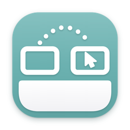
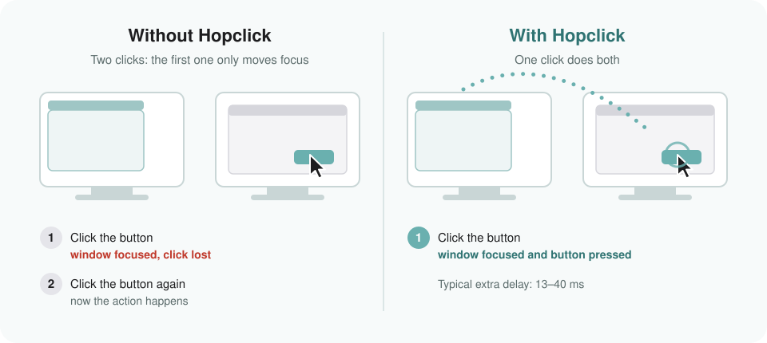
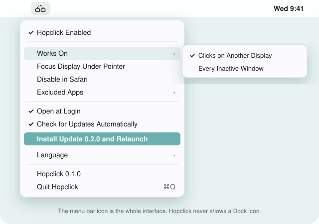
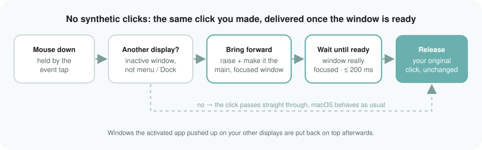

<p align="center">
  
</p>

<h1 align="center">Hopclick</h1>

<p align="center">
  <strong>One click is enough on every display.</strong><br>
  A tiny macOS menu bar app that stops the first click on another monitor from being wasted.
</p>

<p align="center">
  <a href="https://github.com/metin-aydin/Hopclick/actions/workflows/ci.yml"></a>
  <a href="https://github.com/metin-aydin/Hopclick/releases/latest"></a>
  
  <a href="LICENSE"></a>
</p>

With more than one monitor on a Mac you keep moving between displays. When the window you want lives on the
other display, macOS spends your first click only on bringing that window forward. The button, link or tab you aimed
at is not pressed, so you click again. Hopclick makes that first click land where you aimed it.



## Features

- **One click, one action.** Clicking a window on another display focuses it *and* clicks what is under the pointer.
- **Nothing synthetic.** Hopclick never generates or replays clicks. It holds your real click for a moment, brings the
  window forward, then lets the very same click through. One physical click can never turn into two actions.
- **Stays out of the way.** Clicks on the display you are already working on are left to macOS. So are the menu bar,
  the Dock, notifications, open menus, Mission Control, ⌘-click and ⌃-click.
- **Keeps your other displays as they were.** Bringing an app forward also raises its windows on your other displays.
  Hopclick puts the window you had on top there back on top.
- **Your choice of scope.** Use it only for clicks on another display (default), or for every inactive window.
- **Optional focus on pointer.** Turn on *Focus Display Under Pointer* to activate the window under the pointer as
  soon as you move to another display, before you click.
- **Per-app exclusions.** Turn Hopclick off for the frontmost app with one menu click.
- **Lives in the menu bar.** It has no Dock icon and no window. It can start at login and updates itself.
- **English and Turkish**, following the system language or your choice.

## Download

Get the latest **`Hopclick-x.y.z.dmg`** from [Releases](https://github.com/metin-aydin/Hopclick/releases/latest).
Open it and drag **Hopclick** to **Applications**. The app is a universal binary for Apple silicon and Intel Macs,
signed with a Developer ID and notarized by Apple.

Requires macOS 13 Ventura or later.

## Getting started

1. Open Hopclick from Applications. Its icon (two small displays with a dotted hop) appears in the menu bar.
2. Hopclick asks for **Accessibility** permission. Click **Open System Settings** and turn on Hopclick under
   *Privacy & Security › Accessibility*.
3. That's it. Hopclick starts working as soon as the permission is on; you do not need to restart it.

Hopclick needs Accessibility permission to see which window is under the pointer and to bring it forward. It asks
for nothing else: no Screen Recording (window titles are never read), no keystrokes, no files. The only network
request is the update check against GitHub Releases.

## The menu



| Item | What it does |
|---|---|
| **Hopclick Enabled** | Turns Hopclick on or off. When it is off, macOS behaves exactly as usual. |
| **Works On** | *Clicks on Another Display* (default) or *Every Inactive Window*, which also covers inactive windows on the same display. |
| **Focus Display Under Pointer** | When the pointer rests on another display for a moment, the window under it is focused before you click. Off by default. |
| **Disable in *App*** | Excludes the app you were using. *Excluded Apps* lists them; click one to turn Hopclick back on for it. |
| **Open at Login** | Starts Hopclick when you log in. |
| **Check for Updates Automatically** | Checks GitHub Releases shortly after launch and every 6 hours. |
| **Install Update … and Relaunch** | Appears when a new version is out (the menu bar icon also gets a dot). |
| **Language** | System, English or Türkçe. |

## How it works



1. An event tap sees every left mouse-down before any app does.
2. Hopclick decides whether to act. The click must be on a display other than the focused one, land on an ordinary
   window of another app, and not be on the menu bar, Dock, a notification or an open menu.
3. If it acts, Hopclick activates the app and makes the clicked window its main, focused window.
4. It waits until that window really is focused, at most 200 ms (usually 13–40 ms). Asking for activation is not
   enough: an app being activated focuses its own last-used window a moment later, so the request is repeated until
   the clicked window wins.
5. It then returns your original, unmodified click. The app is active by then, so the click reaches the button
   instead of being used up as the activating click.

If anything does not fit (an unresponsive app, an unknown system surface), the click simply passes through as it
would without Hopclick.

## Build from source

```bash
git clone https://github.com/metin-aydin/Hopclick.git
cd Hopclick
swift test                 # unit tests for the click policy
scripts/build-app.sh       # builds build/Hopclick.app (ad-hoc signed)
open build/Hopclick.app
```

Requirements: Xcode 15 or later (or the Command Line Tools with Swift 5.9+). No third-party dependencies.

An ad-hoc signed build gets a new identity on every rebuild, so macOS may ask for Accessibility permission again. To
avoid that, sign with any code-signing identity you have: `SIGN_IDENTITY="Apple Development: …" scripts/build-app.sh`.
Development builds do not update themselves and do not register as a login item unless they run from Applications.

## Releases

Work happens on the `development` branch. A pull request from `development` into `master` publishes a new version:
the release workflow computes the version, builds a universal app, signs it with a Developer ID, notarizes it, and
attaches `Hopclick-x.y.z.dmg` and `Hopclick-x.y.z.zip` to a GitHub release. The pull request description becomes the
release notes. The app updates itself from the zip after verifying that it is signed by the same developer.

## Prior art

Hopclick was designed after studying the existing open-source attempts at this problem:
[ClickThrough](https://github.com/PirouzSR/ClickThrough) (whose measured findings about activation timing shaped the
approach), [another ClickThrough](https://github.com/laiglk/ClickThrough),
[apple-click-through](https://github.com/dainank/apple-click-through) for Hammerspoon and
[AutoRaise](https://github.com/sbmpost/AutoRaise) (focus follows mouse).

## License

[MIT](LICENSE)
